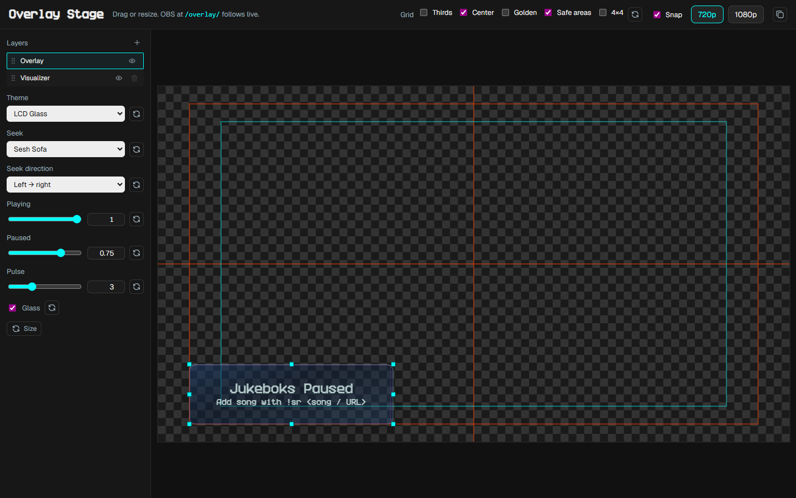
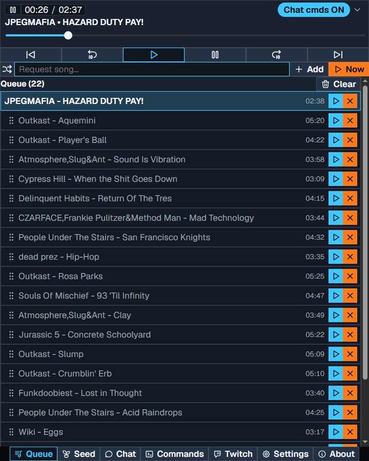

# Quick Start

Set up song requests and the OBS overlay on Windows. You do not need to build from source.

You need a Twitch account, OBS, and a Google account that can play YouTube Music.

## 1. Download and install pear-desktop

JB2 talks to [pear-desktop](https://github.com/pear-devs/pear-desktop) (YouTube Music Desktop). It does not work with the original [YouTube Music Desktop](https://github.com/th-ch/youtube-music).

1. Open the [pear-desktop releases](https://github.com/pear-devs/pear-desktop/releases) page.
2. Download the Windows installer for the latest release and run it.
3. Start pear-desktop and sign in to YouTube Music.

## 2. Download and install JB2

1. Open the [JB2 releases](https://github.com/iamtew/jb2/releases) page.
2. Download the latest Windows MSI or zip.
3. MSI installs to `%LOCALAPPDATA%\Programs\JB2` (no Windows admin) and can add a Start Menu shortcut. Zip: unpack somewhere you can find, then run `jb2.exe`. Keep the `webroot` folder next to the exe.
4. Start JB2. A tray icon appears. The Control Panel is `http://localhost:42420/admin/`.

## 3. Pair pear-desktop

1. Start pear-desktop first, then JB2.
2. The first time they talk, pear-desktop asks you to **Allow** a client named `jb2`. Allow it.
3. Play a track in pear-desktop so you know the player is live.

Flags, ports, and developer builds are in [Running](running.md).

## 4. Configure OBS

1. Open Overlay Stage from the JB2 landing page or the tray: `http://localhost:42420/stage/`. Pick 720p or 1080p and place the now-playing panel.
2. In OBS, add a **Browser** source.
3. URL: `http://localhost:42420/overlay/`
4. Set Width and Height to the same canvas (1920×1080 or 1280×720). OBS follows Stage live.

Details: [Overlay](overlay.md) and [Overlay Stage](stage.md).

## 5. Configure JB2 and Twitch

1. Open the Control Panel: tray **Control Panel**, or `http://localhost:42420/admin/`.
2. Go to **Twitch**.
3. Log the browser out of the streamer account if that is not the bot.
4. **Login with Twitch** and approve as the **bot**. Bot nick is filled from that account. Join channel defaults to the same login if you left it empty.
5. IRC connects after a successful login. Use **Connect** / **Disconnect** if you need to drop or rejoin later.

Chat `!sr` queues songs. Cooldowns and the command list: [Twitch](twitch.md). What a request accepts: [Requests](requests.md).

## 6. Bonus: Control Panel as an OBS dock

Keep the Control Panel next to the stream instead of a separate browser window.

1. Copy the Control Panel URL from the JB2 landing page (**Copy URL** on the Control Panel card), or copy `http://localhost:42420/admin/`.
2. In OBS: **Docks** → **Custom Browser Docks**.
3. Paste the URL, name it Control Panel, and apply.

The URL stays `/admin/`. The page is the Control Panel.
